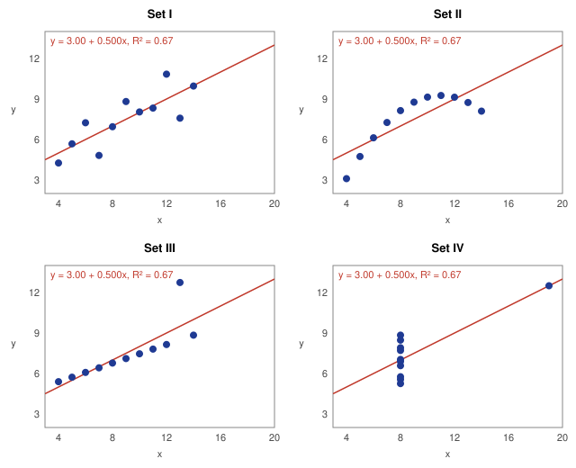
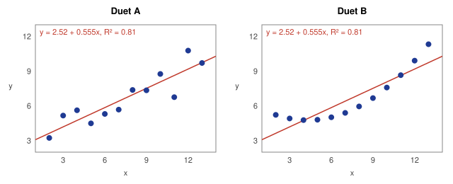

# Go for Statistics: The Anscombe Quartet in Go, Python and R

**Repository (clone URL):** `https://github.com/CHbobray/go-anscombe.git`

This repository answers a management question: can Go, using the [`github.com/montanaflynn/stats`](https://github.com/montanaflynn/stats) package, replace Python and R for the company's statistical work? It reproduces the Anscombe Quartet regressions from Miller (2015, chapter 1) in Go, uses Go's `testing` package to prove the Go results match Python and R, and compares execution time and memory across the three languages.

**Short answer:** Go reproduces R's `summary(lm())` and Python's statsmodels output (coefficients, standard errors, t values, p-values, R², F test) to at least nine decimal places. It runs Miller's whole chapter 1 analysis in 1.5 milliseconds and 13 MB of memory, compared with 0.19 s and 58 MB for R and 2.2 s and 197 MB for Python. It is a sound choice for statistics inside backend services and for heavy simulation. It is not yet a full replacement for R or Python for exploratory data science. See the [recommendation](#recommendation-to-management).

## Contents

- [Assignment deliverables](#assignment-deliverables)
- [Repository layout](#repository-layout)
- [The data](#the-data)
- [Results: Go matches R and Python](#results-go-matches-r-and-python)
- [Execution time and memory](#execution-time-and-memory)
- [Recommendation to management](#recommendation-to-management)
- [How to run the application](#how-to-run-the-application)
- [How to test, benchmark and build](#how-to-test-benchmark-and-build)
- [How to run the Python and R programs](#how-to-run-the-python-and-r-programs)
- [Tests](#tests)
- [References](#references)

## Assignment deliverables

| Deliverable | Where it is |
|---|---|
| Cloneable GitHub URL ending in `.git` | `https://github.com/CHbobray/go-anscombe.git` (submitted in the assignment comments) |
| README with complete documentation, including how to run and test | This file |
| Complete data and code for Go | `anscombe/`, `cmd/anscombe/`, `data/` |
| Complete data and code for Python and R | `python/` and `r/`: Miller's original programs, the same programs with plotting removed, and the benchmark programs. The data are written into each program, exactly as in Miller (2015) |
| Execution times and memory requirements | [Execution time and memory](#execution-time-and-memory), with raw output in `results/` |
| Executable application (`.exe` for Windows, `.app` for macOS) | `bin/` (see [How to run the application](#how-to-run-the-application)) |

## Repository layout

| Path | Role |
|---|---|
| `anscombe/` | The reusable Go package. It works on any x/y data, not just the quartet |
| `anscombe/data.go` | The four Anscombe data sets (Miller 2015, table 1.1) |
| `anscombe/duet.go` | A "duet" of my own: two very different data sets with the same fitted line (Miller's suggestion for the student) |
| `anscombe/regression.go` | `Fit(x, y)`: everything R's `summary(lm())` reports for simple regression: coefficients, standard errors, t values, p-values, residual standard error, R², adjusted R², F test |
| `anscombe/tdist.go` | Student's t distribution (p-values and critical values), which the stats package does not provide |
| `anscombe/plot.go` | Draws scatter plots with fitted lines as SVG, the Go version of Miller's figure 1.5 |
| `anscombe/synthetic.go` | Generates data from a known line plus noise, for tests and the Monte Carlo benchmark |
| `anscombe/*_test.go` | Unit tests, benchmarks and a runnable example |
| `cmd/anscombe/` | The command-line application and its tests |
| `bin/` | Ready-to-run executables: Windows `.exe`, macOS `.app` (zipped), and plain macOS and Linux binaries |
| `macos/Anscombe.app/` | Source of the macOS app bundle (launcher script and `Info.plist`) |
| `python/miller-mtpa-chapter-1-program.py` | Miller (2015) Exhibit 1.1, exactly as provided for the course |
| `python/miller_anscombe.py` | The same program with only the matplotlib plotting removed. This is the program timed against Go |
| `python/anscombe_benchmark.py` | Times Miller's statsmodels code and `scipy.stats.linregress`, and runs the Monte Carlo benchmark |
| `r/miller-mtpa-chapter-1-program.R` | Miller (2015) Exhibit 1.2, exactly as provided for the course |
| `r/miller_anscombe.R` | The same program with only the plotting removed. This is the program timed against Go |
| `r/anscombe_benchmark.R` | Times Miller's `lm()` code and `.lm.fit()`, and runs the Monte Carlo benchmark |
| `benchmark/compare_programs.py` | Runs the complete Go, Python and R programs 20 times each and measures wall time and peak memory |
| `data/` | The quartet as CSV: `anscombe.csv` (all sets) and `anscombe_set1.csv` … `anscombe_set4.csv`, usable with `-csv` |
| `results/` | Saved output from every run reported here (see below) |
| `Makefile` | Shortcuts for testing, benchmarking, profiling, plotting, building and comparing |

Files in `results/`:

| File | Contents |
|---|---|
| `go_output.txt` | Go application output: all four regression summaries, timing, memory, Monte Carlo |
| `go_test_output.txt` | Every Go test, with coverage |
| `go_benchmarks.txt` | `go test -bench` results: time, bytes and allocations per fit |
| `go_run_log.txt` | Timestamped log written by the application (`-log`) |
| `go_cpu_profile.txt`, `go_memory_profile.txt` | Top functions from the Go CPU and memory profiles (`pprof`) |
| `program_comparison.txt` | Whole-program wall time and peak memory, Go vs Miller's Python and R |
| `python_output.txt`, `r_output.txt` | Python and R benchmark output |
| `miller_python_original_output.txt`, `miller_r_original_output.txt` | Output of Miller's original programs, unchanged |
| `anscombe_quartet.svg`, `duet.svg` | Plots drawn by the Go application |

## The data

The Anscombe Quartet (Anscombe 1973) is four small data sets, 11 points each, reproduced in Miller (2015) table 1.1. Plotted, they look completely different: a noisy line, a curve, a straight line with one outlier, and a vertical stack with one high-leverage point. Yet all four give the same regression, ŷ = 3 + 0.5x, with R² = 0.67. Miller's lesson is that statistical summaries do not tell the story of data; we must look at the plots. Here the quartet also serves as a test, because any correct regression routine must reproduce those numbers.

The data appear in four places, all identical: written into Miller's Python and R programs (and the benchmark programs derived from them), in `anscombe/data.go`, and as CSV files in `data/`.

The Go application draws the quartet the way Miller's figure 1.5 does, with the same axis ranges, and adds the fitted lines:



### A duet of my own

Miller's programs end with a suggestion: "See if you can develop a quartet of your own, or perhaps just a duet, two very different data sets with the same fitted model." `anscombe/duet.go` does that. Duet A is a straight line with random scatter, and Duet B is a smooth curve. Both give ŷ = 2.52 + 0.555x with R² = 0.81, which R confirms:



How it was built: Duet A came from y = 2 + 0.6x plus normal noise. Duet B keeps A's fitted values and swaps its residuals for a U-shaped pattern with the same sum of squares that is uncorrelated with x. That leaves the coefficients, standard errors and R² unchanged. Run it with `anscombe -data duet`.

## Results: Go matches R and Python

The Go application prints a summary in the same layout as R's `summary(lm())`. For Set I:

```text
Set I: y = 3.0001 + 0.5001x   (n = 11, mean x = 9.000, mean y = 7.501)
              Estimate  Std. Error   t value   Pr(>|t|)       95% confidence interval
(Intercept)     3.0001      1.1247     2.667    0.02573 *    [  0.4557,   5.5444]
x               0.5001      0.1179     4.241    0.00217 **   [  0.2334,   0.7668]
Residual standard error: 1.237 on 9 degrees of freedom
Multiple R-squared: 0.6665,  Adjusted R-squared: 0.6295
F-statistic: 17.99 on 1 and 9 DF,  p-value: 0.00217
```

R's `summary(lm(y1 ~ x1))` prints the same numbers: `3.0001 1.1247 2.667 0.02573 *` and `0.5001 0.1179 4.241 0.00217 **`. So does statsmodels: `const 3.0001 1.125 2.667 0.026` and `x1 0.5001 0.118 4.241 0.002`.

All three languages give these estimates for the four sets:

| Set | Intercept | Slope | Intercept SE | Slope SE | R² |
|---|---|---|---|---|---|
| I | 3.000091 | 0.500091 | 1.124747 | 0.117906 | 0.666542 |
| II | 3.000909 | 0.500000 | 1.125302 | 0.117964 | 0.666242 |
| III | 3.002455 | 0.499727 | 1.124481 | 0.117878 | 0.666324 |
| IV | 3.001727 | 0.499909 | 1.123921 | 0.117819 | 0.666707 |

`TestFitMatchesR` compares every statistic for every set against R printed to 12 decimals, and requires agreement within 1e-9. All of them pass.

**How the Go regression works.** `stats.LinearRegression` returns fitted points rather than coefficients, so `Fit` recovers the slope and intercept from two fitted points with different x values. R² comes from `stats.Correlation`, and the standard errors use the textbook OLS formulas with `stats.Mean` and `stats.PopulationVariance`. The stats package has no t distribution, so `tdist.go` computes p-values from the regularized incomplete beta function, which is tested against R's `pt()` and `qt()`. Bad input returns an error instead of a wrong answer: unequal lengths, fewer than three points, or a constant x (where the slope is undefined).

## Execution time and memory

Test machine: 2-core Intel Xeon, Linux; Go 1.24.7; Python 3.13.16 with numpy 2.5.3, pandas 3.0.5, scipy 1.18.1, statsmodels 0.15.0; R 4.3.3. Raw output is in `results/`. Timings vary from run to run and machine to machine, so treat the ratios as more meaningful than the exact numbers.

### 1. Whole programs: Miller's Python and R versus Go

This is the comparison a user would notice. Each complete program (start-up, loading packages, fitting all four sets and printing the full summaries) ran 20 times as a separate process, after one warm-up run. Peak memory is the most physical memory (resident set size) the process used, as reported by the operating system. Command: `python3 benchmark/compare_programs.py 20`.

| Program | Mean time per run | SD | Peak memory |
|---|---|---|---|
| **Go** (`anscombe -reps 0 -mc 0`) | **0.0015 s** | 0.0001 s | **13.0 MB** |
| R (Miller's program, plotting removed) | 0.187 s | 0.015 s | 58.4 MB |
| Python (Miller's program, plotting removed) | 2.188 s | 0.109 s | 196.6 MB |

Go finishes about 125 times faster than R and 1,500 times faster than Python, using about a quarter of R's memory and a fifteenth of Python's. Most of the Python and R time is start-up and package loading (pandas and statsmodels, or R itself), which Go avoids by compiling to one self-contained executable.

### 2. The regression code alone

Each program fits all four sets repeatedly and reports the time per fit. "Miller's code" means the calls in Miller's programs, including the summary: `summary(lm(y ~ x))` in R and `sm.OLS(y, sm.add_constant(x)).fit().summary()` in Python. "Lean" means the fastest plain-array routine in the same language, so Go is also compared with the best case for Python and R.

| Program | Fits timed | Time per fit | Memory |
|---|---|---|---|
| **Go** `anscombe.Fit` (full summary statistics, including p-values) | 400,000 | **1.1–1.4 µs** | 672 bytes and 6 allocations per fit; 4.3 MB heap in use; 17 MB from the OS |
| R `.lm.fit()` (lean, coefficients only) | 400,000 | 3.1 µs | |
| R `summary(lm())` (Miller's code) | 40,000 | 653 µs | 72 MB peak R heap (whole benchmark run) |
| Python `scipy.stats.linregress` (lean) | 40,000 | 473 µs | |
| Python statsmodels `OLS().fit().summary()` (Miller's code) | 4,000 | 4,439 µs | 173 MB peak resident memory (whole benchmark run) |

Against Miller's code, Go is about 500 times faster than R and 3,500 times faster than Python. Against R's lean `.lm.fit()`, which computes only coefficients, Go is still about 2.5 times faster while also computing standard errors and p-values. Go's own benchmarks (`results/go_benchmarks.txt`) agree: 1.1–1.3 µs and 672 bytes per Anscombe fit. On larger synthetic samples, time grows linearly with sample size: about 5 µs at n = 100, 50 µs at n = 1,000 and 0.5 ms at n = 10,000.

### 3. Monte Carlo benchmark

Each language draws 100,000 random samples of 100 points from the known line y = 3 + 0.5x + N(0, 1.24²), which matches the Anscombe line and noise level. It fits each sample and checks how often the 95% confidence interval for the slope contains the true value. This measures speed on a realistic simulation workload and, at the same time, checks that the standard errors are correct.

| Language | Time per simulate + fit | Total for 100,000 | Mean slope | 95% CI coverage |
|---|---|---|---|---|
| **Go** | **7.6 µs** | **0.76 s** | 0.50012 | 95.0% |
| R (`.lm.fit()`) | 26.7 µs | 2.67 s | 0.50010 | 95.0% |
| Python (`scipy.stats.linregress`) | 511 µs | 51.1 s | 0.50000 | 95.0% |

All three recover the true slope and give exactly the intended 95% coverage, which confirms that Go's standard errors are right on fresh data, not just on the quartet. Go is about 3.5 times faster than R and 67 times faster than Python here.

### 4. Profiles and logs

`anscombe -log run.log -cpuprofile cpu.prof -memprofile mem.prof` writes a timestamped log and Go `pprof` profiles. `make profile` does this and prints the top functions. The saved profiles (`results/go_cpu_profile.txt`, `results/go_memory_profile.txt`) show that the time goes to the regression itself, mostly the stats package's `LinearRegression`, `Sum` and variance routines, plus the p-value calculation. `stats.LinearRegression` makes the largest memory allocations, because it builds a new series of fitted points on every call. That is the first thing to replace if Go ever needed to be faster still.

## Recommendation to management

**Use Go for statistics that run in production backend services and for heavy simulation, and let data scientists keep Python or R for exploratory work and modeling for now.**

Reasons Go is a good fit:

- **Correct.** The stats package plus a few hundred lines of tested code reproduce R and statsmodels to nine or more decimal places, including p-values. The Monte Carlo test shows the standard errors also hold up on new data.
- **Fast and light.** The whole analysis runs in about 1.5 ms and 13 MB, against 0.19 s and 58 MB for R and 2.2 s and 197 MB for Python. That suits web services that compute statistics per request, and simulation studies that need millions of fits.
- **Easy to deploy.** One self-contained executable per platform, with no interpreter, packages or virtual environments to install.
- **One language.** Models already validated in R or Python can be re-implemented in Go once and served from the same codebase as the rest of the backend.

Concerns data scientists will reasonably raise:

- **Limited library.** `montanaflynn/stats` covers descriptive statistics, correlation and simple regression only. It has no multiple regression, standard errors, p-values, t or F distributions, GLMs, mixed models or time series. This project had to write the standard errors, the t distribution and the plotting itself, all of which are one line in R. [Gonum](https://www.gonum.org/) adds matrix algebra and more distributions, but still falls far short of R or Python's ecosystems.
- **Small community.** As of June 2023 the stats package had 28 contributors and about 15,000 users, compared with the huge user bases, textbooks and Stack Overflow history behind R and Python.
- **No interactive workflow.** There is no mature notebook culture, no equivalent of ggplot2 or matplotlib, and no data frame as convenient as pandas or R's. That is the exact gap the Anscombe Quartet warns about, since analysts need to plot data before trusting a regression.
- **Verbosity.** Work that is one line in R (`summary(lm(y ~ x))`) takes functions, error handling and tests in Go.
- **Hiring and training.** Most data scientists know Python or R, not Go.

**Suggested path:** keep Python and R for research and model development. Port validated models that need to run in production to Go, using unit tests against the R or Python output (as this repository does) to prove each port is correct. Revisit the decision as Go's statistics ecosystem grows.

## How to run the application

No Go installation is needed: download the executable for your computer from `bin/`.

### Windows

Download `bin/anscombe-windows-amd64.exe` and double-click it. A console window shows the four regression summaries, the timing and the Monte Carlo results, and stays open until you press Enter. If Windows SmartScreen warns about an unrecognized app, click **More info → Run anyway**.

To use options, open Command Prompt or PowerShell in the download folder:

```powershell
.\anscombe-windows-amd64.exe -data duet -svg duet.svg
.\anscombe-windows-amd64.exe -csv anscombe_set2.csv -reps 50000
```

### macOS

Download `bin/Anscombe-macOS.zip`, double-click it to unzip, and double-click **Anscombe.app**. It opens a Terminal window and runs the build that matches your Mac (Apple silicon or Intel).

The app is not signed with an Apple developer certificate, so the first time macOS may say it "cannot be opened". Right-click (or Control-click) **Anscombe.app**, choose **Open**, then click **Open** again. Alternatively, run `xattr -dr com.apple.quarantine Anscombe.app` in Terminal.

To use options on a Mac, run the plain binary in Terminal:

```bash
chmod +x anscombe-darwin-arm64        # Intel Macs: anscombe-darwin-amd64
./anscombe-darwin-arm64 -svg quartet.svg
```

### Linux

```bash
chmod +x anscombe-linux-amd64
./anscombe-linux-amd64
```

### Options

```text
-data NAME       built-in data: quartet (default) or duet
-csv FILE        fit your own data instead: a CSV with x in the first column and y in
                 the second; a header row is allowed
-svg FILE        draw a scatter plot of each data set with its fitted line
-reps N          timing repetitions (default 10000; 0 skips timing)
-mc N            Monte Carlo simulations on synthetic data (default 10000; 0 skips)
-n N             observations per Monte Carlo sample (default 100; at least 3)
-seed N          random seed, so a Monte Carlo run can be repeated exactly (default 1)
-log FILE        write a timestamped log of the run
-cpuprofile FILE write a CPU profile (view with: go tool pprof FILE)
-memprofile FILE write a memory profile (view with: go tool pprof FILE)
-h               help
```

The application checks its input and explains problems instead of crashing. It reports a negative or non-numeric number, `-n` below 3, an unknown `-data` name, a stray argument without a dash, an unknown option, a missing CSV file, a CSV line that is not two numbers, a CSV with fewer than three rows, and data where every x is the same. Each message ends by pointing to `-h`.

## How to test, benchmark and build

Install Go 1.21 or later from [go.dev/dl](https://go.dev/dl/), then:

```bash
git clone https://github.com/CHbobray/go-anscombe.git
cd go-anscombe
go test -v -cover ./...                           # run every unit test
go test -bench=. -benchmem -run='^$' ./anscombe   # benchmarks: time and memory per fit
go run ./cmd/anscombe                             # run the application
go run ./cmd/anscombe -data duet -svg duet.svg    # the duet, with its plot
```

With `make` (macOS and Linux):

```bash
make test       # vet and run all tests with coverage
make bench      # Go benchmarks
make plots      # redraw results/anscombe_quartet.svg and results/duet.svg
make profile    # log plus CPU and memory profiles, then the top CPU users
make programs   # whole-program time and memory, Go vs Miller's Python and R
make compare    # regression timing and Monte Carlo benchmark in all three languages
make miller     # run Miller's original programs unchanged
make build      # rebuild every executable into bin/
make app        # rebuild bin/Anscombe-macOS.zip
```

On Windows without `make`, rebuild the executable with:

```powershell
$env:GOOS="windows"; $env:GOARCH="amd64"; go build -o bin/anscombe-windows-amd64.exe ./cmd/anscombe
```

## How to run the Python and R programs

Python needs Python 3 and these packages (matplotlib is used only by Miller's original program):

```bash
pip install numpy pandas scipy statsmodels matplotlib
```

R needs only base R.

```bash
python3 python/miller_anscombe.py               # Miller's Exhibit 1.1 without plotting
Rscript r/miller_anscombe.R                     # Miller's Exhibit 1.2 without plotting
python3 python/anscombe_benchmark.py 1000 100000   # args: reps, Monte Carlo runs, [n]
Rscript r/anscombe_benchmark.R 10000 100000        # args: reps, Monte Carlo runs, [n]
python3 benchmark/compare_programs.py 20           # whole-program comparison with Go
```

Miller's original programs are included unchanged (`make miller` runs them from their own folders, where they write their plot PDFs). The R original runs as published. The Python original fits and prints all four regressions correctly, then stops at its final `plt.savefig()` call, because recent matplotlib versions (3.11 was tested here) no longer accept its `papertype` and `frameon` arguments. As the assignment notes, the plotting is not critical to the test, which is why the timed versions remove it. The Go application draws the equivalent plots with `-svg`.

## Tests

| Test | Checks |
|---|---|
| `TestFitMatchesR` | Every statistic (coefficients, SEs, t values, p-values, R², adjusted R², F, residual SE) for all four sets, within 1e-9 of R |
| `TestQuartetLesson` | Every set gives about ŷ = 3.00 + 0.500x and R² = 0.67 |
| `TestFitPerfectLine` | Exact answer for y = 1 + 2x |
| `TestFitErrors` | Unequal lengths, too few points, empty input, constant x |
| `TestQuartetReturnsCopies` | The built-in data cannot be changed by callers |
| `TestTwoSidedPValueMatchesR`, `TestCriticalTMatchesR`, `TestTwoSidedPValueEdgeCases` | The t distribution against R's `pt()` and `qt()`, plus edge cases |
| `TestFitRecoversSyntheticModel` | On 10,000 synthetic points, the estimates fall within 4 standard errors of the true line |
| `TestStandardErrorCoverage` | Monte Carlo check: across 2,000 synthetic samples, 95% confidence intervals contain the true slope about 95% of the time |
| `TestDuetSameModel`, `TestDuetDifferentShapes` | The duet sets share one fitted model but have different shapes |
| `TestWriteSVG`, `TestWriteSVGRejectsBadInput` | The plot is valid SVG with every data point drawn (44 for the quartet); bad input is rejected |
| `ExampleFit` | Runnable documentation example |
| `TestRunQuartet`, `TestRunCSVMatchesBuiltInSet`, `TestRunDuetWithPlot` | Application output, CSV input reproducing Set I, and the duet with its plot |
| `TestStars` | Significance codes use R's cut-offs (`***`, `**`, `*`, `.`) |
| `TestRunMonteCarlo` | The application's simulation recovers the true slope with about 95% coverage |
| `TestLogAndProfilesAreWritten` | `-log`, `-cpuprofile` and `-memprofile` produce their files |
| `TestParseFlagsRejectsBadInput`, `TestRunRejectsBadFiles` | Every kind of bad option and bad CSV is rejected with an error |

Coverage: 96.4% of the `anscombe` package and 86.6% of the application. The uncovered part is `main`'s exit handling and the Windows "Press Enter" pause. Full output: `results/go_test_output.txt`.

## References

Anscombe, F. J. 1973, February. Graphs in statistical analysis. *The American Statistician* 27: 17–21.

Flynn, M. n.d. stats: A well tested and comprehensive Golang statistics library. GitHub repository. https://github.com/montanaflynn/stats.

Miller, T. W. 2015. *Modeling Techniques in Predictive Analytics with Python and R: A Guide to Data Science.* Upper Saddle River, N.J.: Pearson Education.
